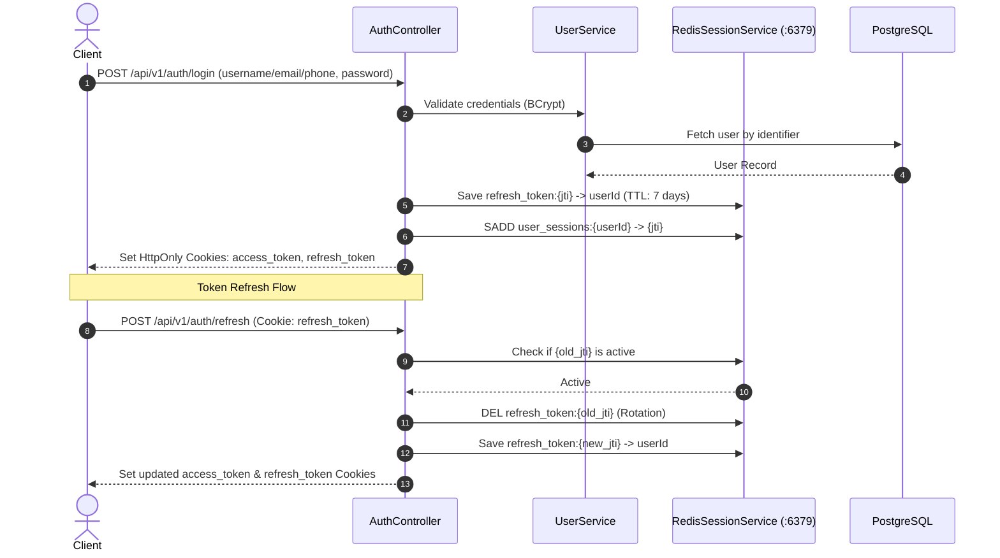

# 🚀 User Service (`user-service`)

[](https://openjdk.org/)
[](https://spring.io/projects/spring-boot)
[](https://www.postgresql.org/)
[](https://redis.io/)
[-black.svg)](https://kafka.apache.org/)
[](https://min.io/)
[](LICENSE)

An enterprise-grade, event-driven **User & Identity Microservice** built with **Spring Boot**, **PostgreSQL 17**, **Redis 7**, **MinIO/LocalStack/S3**, and **Apache Kafka**.

Designed with strict zero-trust security, dual-write consistency via the **Transactional Outbox Pattern**, fuzzy trigram full-text search, direct-to-cloud presigned avatar uploads, dynamic policy enforcement, and a **dedicated Social Graph Redis cache** for high-performance downstream authorization (e.g. `movie-service`).

---

## 📑 Table of Contents
- [Architecture Overview](#-architecture-overview)
- [Key Features](#-key-features)
- [Tech Stack](#-tech-stack)
- [System Workflows](#-system-workflows)
  - [1. Authentication & Redis Session Lifecycle](#1-authentication--redis-session-lifecycle)
  - [2. Password Reset & Out-of-Band Delivery Flow](#2-password-reset--out-of-band-delivery-flow)
  - [3. Dedicated Social Graph Cache & Downstream Access Checks](#3-dedicated-social-graph-cache--downstream-access-checks)
  - [4. Direct S3/MinIO Avatar Upload Flow](#4-direct-s3minio-avatar-upload-flow)
  - [5. Transactional Outbox Domain Event Publishing](#5-transactional-outbox-domain-event-publishing)
- [Database Schema & Search Indexing](#-database-schema--search-indexing)
- [Configuration & Policy Engine](#-configuration--policy-engine)
- [Environment Variables (Production Deployment)](#-environment-variables-production-deployment)
- [API Reference](#-api-reference)
- [Local Infrastructure Setup (Docker Compose)](#-local-infrastructure-setup-docker-compose)
- [Building & Running Locally](#-building--running-locally)
- [Automated Testing Suite](#-automated-testing-suite)

---

## 🏛️ Architecture Overview

```
                                  ┌─────────────────────────────┐
                                  │    API Gateway / Clients    │
                                  └──────────────┬──────────────┘
                                                 │
                        ┌────────────────────────┴────────────────────────┐
                        ▼                                                 ▼
             ┌─────────────────────┐                           ┌─────────────────────┐
             │    user-service     │                           │  Downstream Service │
             │    (Spring Boot)    │                           │ (e.g. movie-service)│
             └──────────┬──────────┘                           └──────────┬──────────┘
                        │                                                 │
      ┌─────────────────┼────────────────────────┐                        │ Read-Only
      ▼                 ▼                        ▼                        ▼
┌───────────┐     ┌───────────┐            ┌───────────┐            ┌───────────┐
│PostgreSQL │     │  Redis 7  │            │  Kafka    │            │Graph Redis│
│ Database  │     │ (Auth &   │            │  Broker   │            │ (Port 6380│
│           │     │ Sessions) │            │  (KRaft)  │            │ Followers)│
│• users    │     │:6379      │            │           │            │           │
│• outbox   │     └───────────┘            │•registered│            │• following│
│• follows  │                              │•deactivate│            │• privacy  │
└───────────┘                              │•pwd-reset │            └───────────┘
                                           └───────────┘
```

---

## ✨ Key Features

### 🛡️ Enterprise Security & Authentication
- **Dual Token Architecture**:
  - **Access Token**: Short-lived (15 minutes), stateless HMAC-SHA256 JWT.
  - **Refresh Token**: Long-lived (7 days) with unique UUID JWT ID (`jti`) persisted in Redis.
- **Cookie Security**: Tokens delivered via `HttpOnly`, `SameSite=Strict`, `Secure` cookies with automatic fallback to `Authorization: Bearer <token>` headers for mobile clients.
- **Token Rotation & Instant Revocation**: Every refresh request rotates the token and invalidates the previous `jti`. User logout or account deactivation instantly purges session keys across all user devices.
- **Production-Grade Password Reset & Victim Protection**:
  - **Zero HTTP Token Leakage**: The HTTP response never returns `resetToken`, returning only a generic anti-enumeration response (`{"message": "If an active account exists..."}`).
  - **Transactional Outbox Event Dispatch**: Emits `user.password-reset-requested.v1` atomically in PostgreSQL for asynchronous out-of-band delivery (email/SMS) to the legitimate user.
  - **Anti-Bombing Cooldown**: Per-user Redis cooldown prevents attackers from flooding a victim's mailbox with repeated triggers.
  - **Session Invalidation**: Completing a reset revokes all active refresh tokens across all devices and validates against identical previous password reuse.
  - **Authenticated Change Password**: `PUT /api/v1/users/me/password` verifies the current password and revokes all other active sessions.
- **Anti-Spoofing Context**: `JwtAuthenticationFilter` validates caller identity and enforces trusted boundary verification before population of the thread-local `UserContext`.
- **Google OAuth Integration**: Native Google ID Token verification (`com.google.api-client`), auto-provisioning new accounts or linking existing email identities.

### 👥 Dedicated Social Graph Redis & Downstream Authorization
- **Isolated Graph Cache**: Dedicated Redis container on port `6380` isolated from auth sessions, eliminating blast radius and session eviction risks.
- **Real-Time Consistency**: Follow, unfollow, follower removal, accept/reject, registration, and privacy toggles update the graph cache synchronously.
- **Anti-Penetration Sentinel**: Users following 0 people store an `__EMPTY__` sentinel to prevent cache misses on empty sets.
- **Downstream Batched APIs & Review Privacy Access**: Downstream services (e.g. `movie-service`) can fetch viewer followings and multiple author privacy flags via `POST /api/v1/users/access-context` with automatic DB-to-Redis cache warming. Single-check endpoint `GET /api/v1/users/{id}/access-check` evaluates author privacy vs. viewer follow status for fine-grained review & ratings visibility.

### 🔍 PostgreSQL Trigram Fuzzy Search (`pg_trgm`)
- Native inverted **GIN trigram indexes** (`idx_users_username_trgm`, `idx_users_bio_trgm`) provisioned on startup via `DatabaseInitializer`.
- Typo-tolerant substring and similarity search scoring (`similarity(username, :q) > 0.2`) with exact prefix boosting.

### 🖼️ S3 / MinIO / LocalStack Profile Picture Presigned URLs
- **Direct-to-Cloud Uploads**: Backed by AWS SDK v2 (`S3Presigner`), clients upload large binaries directly to MinIO, LocalStack, or AWS S3 via SigV4 presigned PUT URLs, offloading network I/O from the app.
- **Policy Enforcement**: Pre-validates file sizes (max 5 MB) and MIME types (`image/jpeg`, `image/png`, `image/webp`).
- **Orphan Cleanup**: Updating a profile photo automatically triggers an asynchronous background deletion of the previous avatar object in S3/MinIO.

### 📬 Transactional Outbox Pattern (Apache Kafka)
- Prevents dual-write bugs and phantom events.
- Domain events (`user.registered.v1`, `user.deactivated.v1`, `user.password-reset-requested.v1`) are written atomically to the `outbox_events` table inside the exact same database transaction as business logic.
- Background scheduled poller (`OutboxPublisherService`) batches pending events, publishes them to Kafka with retry counters, and marks records `PUBLISHED` upon delivery confirmation.

---

## 🛠 Tech Stack

| Component | Technology | Version |
| :--- | :--- | :--- |
| **Language** | Java (OpenJDK) | 21 |
| **Framework** | Spring Boot | 4.1.1 |
| **Database** | PostgreSQL | 17 (Alpine) |
| **Auth Caching & Sessions** | Redis | 7 (Alpine, Port 6379) |
| **Social Graph Cache** | Redis | 7 (Alpine, Port 6380) |
| **Event Streaming** | Apache Kafka (KRaft mode) | 3.8.0 |
| **Object Storage** | MinIO / LocalStack / AWS S3 (AWS SDK v2) | 2.29.50 |
| **Security & JWT** | JJWT (io.jsonwebtoken) | 0.12.6 |
| **Password Hashing** | Spring Security Crypto (BCrypt) | Latest |
| **OAuth** | Google API Client | 2.7.0 |
| **Build Tool** | Apache Maven | 3.9+ |

---

## 🔄 System Workflows

### 1. Authentication & Redis Session Lifecycle



---

## ⚙️ Configuration & Policy Engine

Policy rules are completely decoupled into `src/main/resources/user-policy.yml`:

```yaml
user-policy:
  auth:
    mode: EITHER           # EITHER (email or phone), BOTH, ONLY_EMAIL, ONLY_PHONE
    allow-google: true     # Enable / Disable Google OAuth
  profile:
    username:
      min-length: 3
      max-length: 30
      regex: "^[a-zA-Z0-9_.]+$"
    bio:
      max-length: 160
    avatar:
      max-size-bytes: 5242880 # 5 MB
      allowed-content-types:
        - "image/jpeg"
        - "image/png"
        - "image/webp"
  deactivation:
    grace-period-days: 30
```

---

## 🌐 Environment Variables (Production Deployment)

The service follows the **12-Factor App methodology**. Every configuration parameter supports environment variable overrides with local defaults (`${ENV_VAR:default}`):

| Environment Variable | Description | Local Default | Production Recommendation |
| :--- | :--- | :--- | :--- |
| `DB_URL` | JDBC URL for PostgreSQL | `jdbc:postgresql://localhost:5432/userServiceDB` | Cloud managed DB (e.g. AWS RDS) |
| `DB_USERNAME` | PostgreSQL username | `postgres` | Least-privileged database user |
| `DB_PASSWORD` | PostgreSQL password | `password` | Injected via Secret Manager |
| `JPA_DDL_AUTO` | Hibernate schema mode | `update` | `validate` or `none` |
| `JPA_SHOW_SQL` | Hibernate SQL logging | `true` | `false` |
| `REDIS_HOST` | Auth Redis hostname | `localhost` | AWS ElastiCache / Redis cluster |
| `REDIS_PORT` | Auth Redis port | `6379` | `6379` |
| `REDIS_PASSWORD` | Auth Redis password | *(empty)* | Secure Redis auth secret |
| `GRAPH_REDIS_HOST` | Dedicated Graph Redis hostname | `${REDIS_HOST}` | Independent Graph Redis cluster |
| `GRAPH_REDIS_PORT` | Dedicated Graph Redis port | `6380` (6379 test) | `6380` |
| `GRAPH_REDIS_DATABASE` | Graph Redis logical DB index | `1` | `0` or isolated DB |
| `JWT_SECRET` | HMAC-SHA256 signature key | *(32+ char key)* | 256-bit cryptographically random secret |
| `JWT_COOKIE_SECURE` | Enable `Secure` cookie flag | `false` | **`true`** (Strictly required for HTTPS) |
| `GATEWAY_SHARED_SECRET` | Secret for `X-Gateway-Secret` | `local-dev-gateway-secret` | High-entropy gateway token |
| `S3_ENDPOINT` | MinIO or AWS S3 / LocalStack endpoint | `http://localhost:9000` | Empty or `https://s3.us-east-1.amazonaws.com` |
| `S3_REGION` | S3 AWS region | `us-east-1` | Target AWS region |
| `S3_BUCKET_NAME` | S3 bucket for avatars | `user-avatars` | Production S3 bucket name |
| `S3_ACCESS_KEY` | S3 Access Key ID | `minioadmin` | AWS IAM role / access key |
| `S3_SECRET_KEY` | S3 Secret Access Key | `minioadmin` | AWS IAM secret access key |
| `S3_PATH_STYLE_ACCESS` | Use path-style S3 URLs | `true` (MinIO/LocalStack) | `false` (AWS S3 virtual hosted style) |
| `KAFKA_BOOTSTRAP_SERVERS` | Kafka broker address list | `localhost:9092` | Managed Kafka (e.g. AWS MSK, Confluent) |

---

## 📡 API Reference

### 1. Authentication Endpoints (`/api/v1/auth`)

| Method | Endpoint | Description | Auth Required |
| :--- | :--- | :--- | :---: |
| `POST` | `/api/v1/auth/register` | Register new user account | No |
| `POST` | `/api/v1/auth/login` | Login with username/email/phone & password | No |
| `POST` | `/api/v1/auth/google` | Sign in or auto-provision with Google ID Token | No |
| `POST` | `/api/v1/auth/refresh` | Rotate session tokens using refresh cookie | Yes (Cookie) |
| `POST` | `/api/v1/auth/logout` | Revoke session and clear cookies | Yes (Cookie) |
| `POST` | `/api/v1/auth/forgot-password` | Request password reset (anti-enumeration, out-of-band delivery) | No |
| `POST` | `/api/v1/auth/reset-password` | Reset password using one-time token | No |

#### Forgot Password Request:
```json
// POST /api/v1/auth/forgot-password
{
  \"identifier\": \"john@example.com\"
}

// Response (Status: 200 OK - Token NEVER returned in HTTP body)
{
  \"message\": \"If an active account exists with that identifier, instructions to reset your password have been sent.\"
}
```

---

### 2. User & Profile Endpoints (`/api/v1/users`)

| Method | Endpoint | Description | Auth Required |
| :--- | :--- | :--- | :---: |
| `GET` | `/api/v1/users/{id}` | Get user profile by UUID | Optional |
| `GET` | `/api/v1/users/by-username/{username}` | Get user profile by username | Optional |
| `POST` | `/api/v1/users/batch` | Batch fetch multiple user profiles by ID list (request body) | Optional |
| `GET` | `/api/v1/users/batch?ids=...` | Batch fetch multiple user profiles by query params (`ids=id1,id2`) | Optional |
| `PUT` | `/api/v1/users/me` | Update authenticated user's profile | **Yes** |
| `PUT` | `/api/v1/users/me/password` | Change password with current password verification | **Yes** |
| `POST` | `/api/v1/users/me/avatar/presigned-url` | Generate S3 presigned upload URL | **Yes** |
| `DELETE` | `/api/v1/users/me` | Deactivate account and revoke all sessions | **Yes** |
| `GET` | `/api/v1/users/search?q={query}` | Typo-tolerant trigram search | No |

#### Batch Users Request:
```json
// POST /api/v1/users/batch
{
  \"ids\": [
    \"a1111111-0000-0000-0000-000000000000\",
    \"b2222222-0000-0000-0000-000000000000\"
  ]
}
```

---

### 3. Follow & Social Graph Endpoints (`/api/v1/users`)

| Method | Endpoint | Description | Auth Required |
| :--- | :--- | :--- | :---: |
| `POST` | `/api/v1/users/follows` | Follow a user (body: `{ \"targetUserId\": \"...\" }`) | **Yes** |
| `POST` | `/api/v1/users/{id}/follow` | Follow a user via path parameter | **Yes** |
| `DELETE` | `/api/v1/users/follows/{targetUserId}` | Unfollow a user | **Yes** |
| `DELETE` | `/api/v1/users/{id}/unfollow` | Unfollow a user via path parameter | **Yes** |
| `DELETE` | `/api/v1/users/followers/{followerId}` | Remove a follower from current user's followers list | **Yes** |
| `DELETE` | `/api/v1/users/me/followers/{followerId}` | *(Alias)* Remove a follower from current user's followers list | **Yes** |
| `POST` | `/api/v1/users/follows/respond` | Accept/Reject follow request | **Yes** |
| `GET` | `/api/v1/users/follows/pending` | List incoming pending follow requests awaiting approval | **Yes** |
| `GET` | `/api/v1/users/me/follow-requests/pending` | *(Alias)* List incoming pending follow requests | **Yes** |
| `GET` | `/api/v1/users/me/follow-requests/sent` | List outgoing follow requests sent by current user awaiting approval | **Yes** |
| `GET` | `/api/v1/users/follows/sent` | *(Alias)* List outgoing follow requests sent by current user | **Yes** |
| `GET` | `/api/v1/users/{id}/followers` | List paginated followers of a user | No |
| `GET` | `/api/v1/users/{id}/following` | List paginated users followed by user | No |
| `GET` | `/api/v1/users/{id}/follow-status?viewerId={viewerId}` | Direct relationship status check (`isFollowing`, `status`) | Optional |
| `GET` | `/api/v1/users/{id}/access-check?viewerId={viewerId}` | Single check if viewer can see private author content (reviews/ratings) | Optional |
| `POST` | `/api/v1/users/access-context` | Batch fetch author privacy & viewer followings (with cache warming) | No |

#### Check Follow Status:
```json
// GET /api/v1/users/{targetUserId}/follow-status
// Response:
{
  \"currentUserId\": \"11111111-0000-0000-0000-000000000000\",
  \"targetUserId\": \"22222222-0000-0000-0000-000000000000\",
  \"isFollowing\": true,
  \"status\": \"ACCEPTED\"
}
```

#### Batch Access Context Request (`POST /api/v1/users/access-context`):
Used by downstream services (like `movie-service`) when rendering paginated review feeds:
```json
{
  \"viewerId\": \"b1a2c3d4-0000-0000-0000-000000000000\",
  \"authorIds\": [
    \"a1111111-0000-0000-0000-000000000000\",
    \"a2222222-0000-0000-0000-000000000000\"
  ]
}
```

#### Response:
```json
{
  \"viewerId\": \"b1a2c3d4-0000-0000-0000-000000000000\",
  \"viewerFollowing\": [
    \"a2222222-0000-0000-0000-000000000000\"
  ],
  \"authorPrivacy\": {
    \"a1111111-0000-0000-0000-000000000000\": false,
    \"a2222222-0000-0000-0000-000000000000\": true
  }
}
```

---

## 🐳 Local Infrastructure Setup (Docker Compose)

The repository provides a complete multi-container stack orchestrated via [`docker-compose.yml`](docker-compose.yml):

```bash
docker compose up -d
```

### Services Started:
- **PostgreSQL 17** (`localhost:5432`): Database `userServiceDB`, User `postgres`, Password `password`.
- **Redis 7 (Auth & Sessions)** (`localhost:6379`): Session storage and token revocation engine.
- **Redis 7 (Social Graph)** (`localhost:6380`): Dedicated follower graph and privacy status cache.
- **LocalStack 4.4.0** (`localhost:4566`): Fully functional AWS S3 emulation for local cloud testing.
- **MinIO S3** (`localhost:9000`, Web UI Console: `http://localhost:9001`): User `minioadmin`, Password `minioadmin`.
- **MinIO Bucket Auto-Init (`create-buckets`)**: Automatically provisions `user-avatars` bucket with public read access.
- **Apache Kafka 3.8.0** (`localhost:9092`): Running in modern KRaft mode (ZooKeeper-less).

To stop all services:
```bash
docker compose down -v
```

---

## 💻 Building & Running Locally

### Prerequisites
- JDK 21+
- Docker & Docker Compose
- Maven 3.9+ (or use included `./mvnw`)

### 1. Start Infrastructure
```bash
docker compose up -d
```

### 2. Run Application
```bash
./mvnw spring-boot:run
```
The service will start on `http://localhost:8080`.

---

## 🧪 Automated Testing Suite

The project includes unit, repository, and end-to-end integration tests using MockMvc, `@SpringBootTest`, and in-memory mock interceptors:

```bash
./mvnw clean test
```

### Coverage Highlights (All 31 Tests Passing):
- **`PasswordResetIntegrationTest`**: Verifies zero HTTP token leakage, Transactional Outbox event dispatching, victim-ID targeting resistance, spam cooldown, cross-device multi-session revocation, and password anti-reuse enforcement.
- **`UserAccessIntegrationTest`**: Dedicated Graph Redis real-time sync on follow/unfollow/approval/follower removal, single access check evaluation, direct follow relationship status, pending & sent follow request listings, and batch access context with automatic cache warming.
- **`AuthControllerIntegrationTest`**: Complete cookie authentication lifecycle, token rotation, and Redis instant revocation.
- **`UserSecurityIntegrationTest`**: Strict header anti-spoofing tests, bearer token parsing, and user context isolation.
- **`UserSearchIntegrationTest`**: Fuzzy trigram similarity search queries and username collision checks.
- **`AvatarPresignedUrlIntegrationTest`**: SigV4 upload URL signing and orphan avatar deletion lifecycle.
- **`OutboxIntegrationTest`**: Atomic transaction event saving, Kafka publishing, and retry status transitions.

---

## 📄 License
This project is licensed under the Apache 2.0 License.
